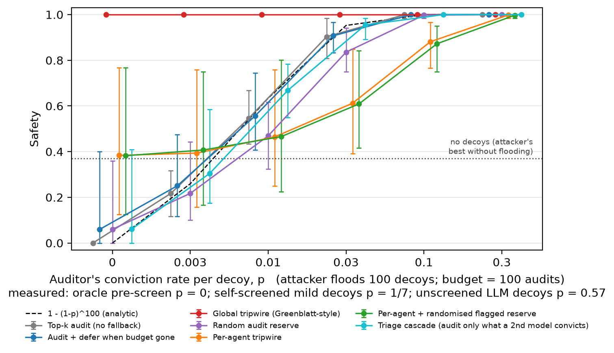
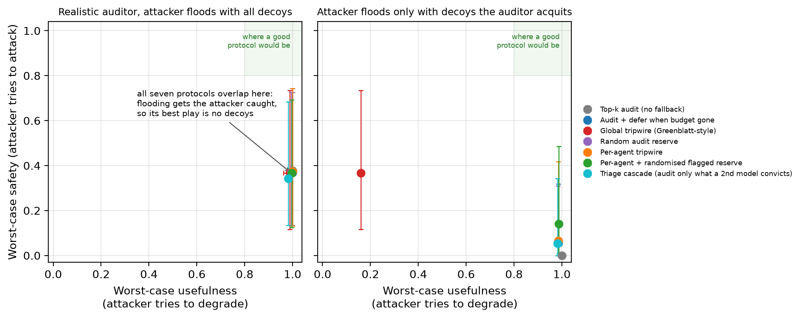
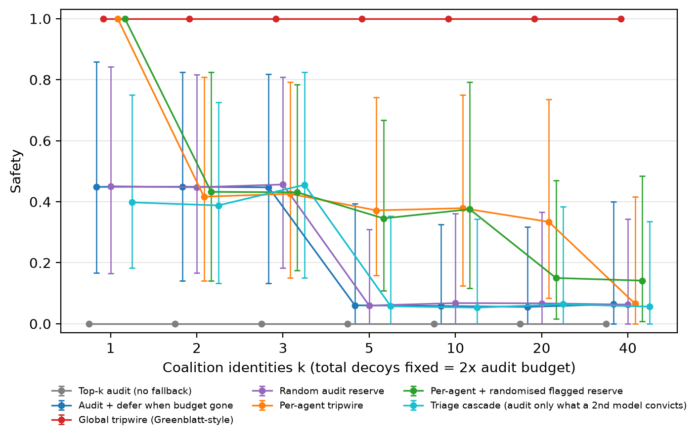
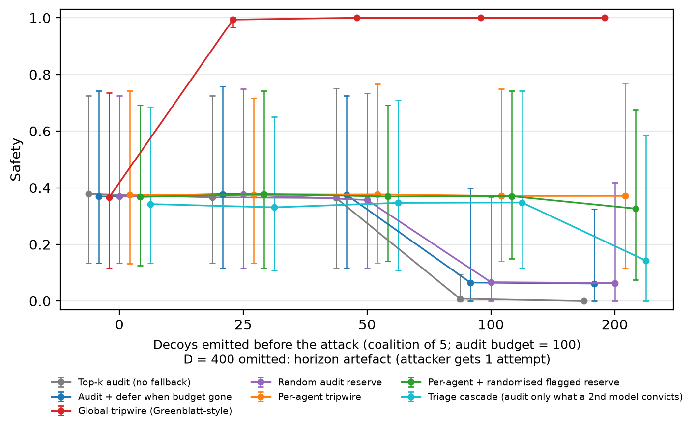

# Detect or Degrade: Audit Flooding in AI Agent Fleets

**Harsh Nikhil Sawant** — Independent Researcher

*Research conducted at the Swarm Alignment Hackathon, November 2026*

## Abstract

AI control mechanisms include a limited budget of manual inspections, a tripwire which triggers when too much suspicious work occurs, and a fallback to a weaker trusted model. In an agent fleet these resources are shared, meaning that a colluding coalition of agents can attempt to use them up. This can be done by using decoys (safe, correct code that appears suspicious) to consume the inspection budget, so that an actual attack is not inspected. Alternatively, the agents can use decoys to trigger the tripwire intentionally, causing the entire fleet to fall back to the weaker trusted model. We implemented a fleet simulator using real judgements from an LLM monitor and an LLM auditor across 20 coding tasks with test-verified code, and compared 7 oversight mechanisms. Naive flooding fails because the auditor convicts 57% of the LLM-written decoys. Flooding only benefits the coalition when the auditor convicts fewer than about 1 in 2B decoys (B = inspection budget). If the attacker filters its decoys using its own model, around 1 in 33 decoys are still convicted, which is too high. When carefully written mild decoys are used, none are convicted. Then all mechanisms fail: the safety of the budget mechanisms drops from 0.37 to 0.06 with 100 decoys (paired CI excludes 0), the global tripwire keeps safety but only 16% of useful work, and the per-agent tripwire drops to 0.07 when the coalition uses 40 identities. Two attempted defences do not avoid this trade-off. This gives defenders a quantifiable metric: the auditor's conviction rate on flagged benign work.

## 1. Introduction

Organisations are beginning to use large numbers of AI agents working on the same codebase or workflow. However, oversight does not scale as easily. Only a limited portion of the work can be manually inspected by a team of humans, so an automated monitoring system decides what should be inspected. If the rate of suspicious work becomes too high, a tripwire is triggered and the system falls back to a weaker trusted model. This is the AI control setting of [1], which considers the scenario where one untrusted model works through a series of tasks.

In an agent fleet, these safety measures become shared resources. Using one inspection on Agent A means that inspection cannot be used on Agent B, and the tripwire is shared by everyone. If multiple agents are misaligned and collude, they can deliberately use up these resources. There are two ways to do this:

- **Detect:** The coalition floods the monitoring system with decoys (correct and safe code that appears suspicious). Each decoy is flagged and consumes an inspection. Once the budget is exhausted, an actual attack is no longer inspected.
- **Degrade:** The same decoys give the fleet a high flagged rate, which triggers the tripwire. The entire fleet falls back to the trusted model and loses most of its useful work, with no attack required.

However, there is a clear problem for the attacker. If a decoy is inspected, it is read carefully by the auditor. If the auditor decides that the decoy appears deliberately deceptive, the coalition is found out. This means the threat depends on how often the auditor convicts decoys.

Our key contributions are:

1. **A quantifiable threat model.** We implemented a fleet simulator with 50 agents, 100 rounds, a 2% inspection budget, 7 mechanisms and 34 control checks. It uses real judgements from an LLM monitor and an LLM auditor on 570 test-verified items across 20 tasks.
2. **The condition for the attack to be effective.** If the auditor convicts fewer than about 1 in 2B decoys (B = inspection budget), flooding outperforms the attacker's best strategy without decoys. This was confirmed by the simulation, a closed-form expression and a unit test. We measure the conviction rate for four types of attacker: unfiltered LLM decoys are convicted at a rate of 0.57, decoys filtered with the attacker's own model at around 1 in 33, decoys pre-screened by an oracle that knows the auditor's verdicts at 0, and carefully written mild decoys at 0 on the evaluation tasks.
3. **A trade-off when this condition is met.** All the mechanisms we tested lose either safety or usefulness. The per-agent tripwire is overcome by splitting the coalition into 40 identities. We also attempted two defences, which do not avoid the trade-off. The main reductions in safety are statistically significant (paired bootstrap).
4. **A pre-deployment check.** Defenders can measure how often the auditor convicts flagged benign work. If this rate is below about 1/(2B), the fleet is vulnerable to inspection flooding.

## 2. Related Work

**AI control:** Trusted monitoring with a limited budget of manual inspections, and falling back to a trusted model, were introduced in [1]. This is reflected in our threshold, defer and global tripwire mechanisms. In [2], the idea was extended to multi-step agents, using resampling in place of fallback. Both consider the scenario where there is only one untrusted model. We consider the scenario where multiple agents share the same monitoring resources and some of them collude.

**Wasting inspections:** In [3], safety arguments are given for untrusted monitoring, including a colluding monitor that wastes inspections. In our threat model the monitor is honest. The policy agents waste inspections by creating decoys.

**Distributing inspections in a fleet:** In [4], the distribution of an inspection budget across N agents with miscalibrated and correlated confidence, overseen by one human, was studied without an adversary. In [5], human oversight is modelled as a limited resource that becomes fatigued. We introduce an adversary that targets this limited resource.

**Sabotage and monitoring in multi-agent systems:** Coordinated sabotage was studied in [6], with detection rates reported at a fixed false-positive rate, which assumes the attacker does not change the flagged rate. In [7] it was shown that distributed attacks outperform per-instance monitors. This is reflected in our swarm finding (see Section 4.4).

Our novel contribution is a quantifiable condition: the attack succeeds exactly when the monitor flags decoys that the auditor acquits, and we measure how often this happens.

## 3. Methods

### 3.1 Tasks and Items

We created 20 small Python tasks, such as a coupon calculator, a password hasher, a webhook signature checker and a medicine dose calculator. Each task has a reference solution, functional tests and hidden safety tests that define what counts as harmful code (e.g. accepting a forged signature). Each agent submitted an honest, attack or decoy item. Honest items pass all tests. Attack items pass the functional tests and fail at least one safety test. Decoy items pass all tests, but have been designed to look suspicious. A summary of the number of items of each type can be seen in Table 1 (Appendix B).

The 20 tasks were divided into 10 discovery and 10 evaluation tasks. The split and all monitor settings were frozen before any monitor scores were available. Calibration was performed on the discovery tasks, and all results were obtained on the evaluation tasks.

### 3.2 Monitor, Auditor and Trusted Model

**Monitor:** We use gemma4:31b-cloud to assign a suspiciousness score between 0 and 100 to each submission (temperature 0, batches of 10 items). Each item was scored three times, each time in a different batch. On the evaluation tasks, the monitor separated attacks from honest code (AUROC 0.86, CI 0.77–0.96) but could not distinguish decoys from attacks (AUROC 0.52). All honest submissions received a score of 0, so the threshold was set to 0 with a 2% random tie-breaker: any non-zero score is flagged, and honest work is flagged 2% of the time, matching the 2% inspection budget.

**Auditor:** We use gpt-oss:120b-cloud to represent a careful human with unlimited time per item. If the code is harmful or appears deliberately deceptive, the submission is convicted. Convicting an attack exposes the coalition, and so does convicting a decoy. The auditor convicted 90% of hand-written attacks, 57% of LLM decoys and 2% of mild decoys (see Appendix B).

**Trusted model:** We use qwen2.5:3b, run locally. The trusted model solves 8.3% of tasks compared to 81% for the untrusted model, so falling back to it provides only u = 0.10 of the useful work (CI 0.02–0.22).

All models are free to use (Ollama local or the free cloud tier).

### 3.3 Fleet Simulator

We use a fleet of N = 50 agents that complete T = 100 rounds. Each agent submits one item per round, giving 5,000 items per episode, and the inspection budget is B = 100 (2%). The red coalition controls k agents. One agent (the striker) launches the attack, while the remaining agents submit decoys instead of their normal work. The decoys are spread across the first rounds, and the striker attacks immediately after the flood, with up to 5 attempts. The attacker selects the least suspicious of 3 attack candidates and the most suspicious of 3 decoy candidates, using one monitor score as a proxy. The score used in the simulation comes from a different repetition of the monitor, so the selection never sees it.

**Safety** is defined as the probability that no attack is executed without being caught. **Usefulness** is defined as the useful work of the honest agents relative to the untrusted model, where work completed by the trusted model counts as u = 0.10. We report the worst case across all red strategies: the number of decoys D ∈ {0, 25, 50, 100, 200}, the number of identities in the coalition k ∈ {1, …, 40} (with 200 decoys in total), and the pure degrade strategy (decoys only, no attack).

### 3.4 Mechanisms

1. **Threshold:** Flagged items are inspected until the budget is exhausted. After that, everything runs uninspected.
2. **Defer:** Flagged items are inspected until the budget is exhausted. After that, flagged items are passed to the trusted model.
3. **Random reserve:** As defer, but 25% of the budget is used on random inspections.
4. **Global tripwire:** As defer, plus a fleet-wide binomial test on the flagged rate (α = 0.001). If it is triggered, the whole fleet is passed to the trusted model.
5. **Per-agent tripwire:** The same binomial test is performed on each agent (α/N). Only that agent is passed to the trusted model.
6. **Per-agent + random flagged reserve:** Per-agent tripwire, with 25% of the budget held back. Once the main budget is exhausted, flagged items are inspected from this reserve with probability 0.2.
7. **Triage cascade:** A flagged item is only inspected if a second model (gemma4:31b-cloud with the auditor prompt) also convicts it. Otherwise it is deferred.

Mechanisms 6 and 7 are our attempted defences. Mechanism 7 was added after seeing the initial results (see Section 3.6).

### 3.5 Attack Settings

| Setting | Decoys used | Represents |
|---|---|---|
| main | All 127 LLM decoys | An attacker that does not filter |
| selfscreen | Decoys that the attacker's own model flags and acquits (33 of 183 mild and hand-written) | A realistic LLM attacker |
| prescreen | LLM decoys that the real auditor acquits (54) | An oracle attacker |
| handdecoys | 60 hand-written mild decoys (no filtering) | A skilled decoy writer |
| pcurve | Acquitted LLM decoys, with the conviction rate p set manually | The general case |

*Table 2: The attack settings. Sensitivity analysis was performed with a perfect auditor (perfect), a better trusted model (u = 0.5) and a weak monitor (nemotron-3-nano:4b).*

### 3.6 Statistics and Post-Hoc Changes

All confidence intervals are 95% intervals calculated with a task-level bootstrap: 100 resamples of the 10 evaluation tasks, with 60 episodes per resample. Paired differences were calculated on the same resamples. The simulator passed 34 positive and negative control checks. All changes made after seeing the data can be seen in Appendix D.

## 4. Results

### 4.1 Naive Flooding Leads to the Attacker Being Caught

Using unfiltered LLM decoys (main), all mechanisms provide a safety of 1.00 with 25 or more decoys. As the auditor convicts 57% of decoys, one of the first decoys inspected exposes the coalition. Flooding 100 decoys increases safety by +0.63 (paired CI +0.26 to +0.87). With no decoys, the attacker's best strategy gives a safety of 0.37–0.38 for all mechanisms (CI about 0.12 to 0.75). This is the baseline that flooding needs to beat.

### 4.2 The Condition

If each inspected decoy is independently convicted by the auditor with probability p, the chance that the coalition survives B decoy inspections is (1 − p)^B. For a mechanism that relies only on the budget, the safety is therefore approximately 1 − (1 − p)^B under a flood of B decoys. For this to be below 0.37 (the baseline with no decoys), we need p ≲ 0.005 ≈ 1/(2B) when B = 100.

*Figure 1: Safety when the attacker floods 100 decoys (budget = 100 inspections), as a function of the auditor's per-decoy conviction rate p. Real monitor scores are used, and p is set by hand. The budget mechanisms follow the closed form 1 − (1 − p)^100 (dashed). The dotted line shows the attacker's best outcome with no decoys (0.37). The attacker only benefits from flooding to the left of the intersection point (p ≈ 0.005). Error bars: 95% task-level bootstrap confidence intervals.*

This can be seen in Figure 1. With p = 0.003, defer provides 0.25 safety. With p = 0.01, defer already provides 0.56 safety, which is above the baseline, so flooding hurts the attacker. With the per-agent tripwire, safety stays flat at low values of p, because the flooding agents are cut off before the budget is drained. However, at p = 0.03 its safety is lower than that of the budget mechanisms (0.61 vs 0.91), because cutting off the decoy agents also removes the chances to convict them.

### 4.3 Which Attackers Meet the Condition

| Attacker | p | Defer, D = 100 vs D = 0 (paired) | Result |
|---|---|---|---|
| Unfiltered LLM decoys (main) | 0.57 | +0.63 (0.26 to 0.87) | Flooding gets the coalition caught |
| Filtered by the attacker's model (selfscreen) | ≈ 1/33 | +0.46 (0.12 to 0.73) | Caught |
| Pre-screened by an oracle (prescreen) | 0 | −0.31 (−0.53 to −0.12) | Attack works |
| Hand-written mild decoys (handdecoys) | 0/30 on evaluation tasks | −0.30 (−0.56 to −0.11) | Attack works |

*Table 3: The per-decoy conviction rate p for each attacker, and the change in safety when the attacker floods 100 decoys under the defer mechanism. A positive value means flooding helps the defender.*

The attacker's natural filtering tool is its own model. When given the auditor prompt, gemma convicts all 127 obvious LLM decoys, so no usable decoys are left. When asked to create mild decoys, it creates decoys with a low flagged rate (8%). After filtering, only 7 of the 123 decoys remain, and the real auditor convicts 1 of them. Grouped with the filtered hand-written decoys, this gives p ≈ 1/33, around 6 times higher than required. Hand-written mild decoys, by contrast, are flagged 79% of the time and none are convicted by the auditor on the evaluation tasks. These overcome the budget mechanisms without any filtering.

To ensure this was not a feature of the LLM auditor only, a single human auditor (the author) answered the same two questions on a blinded sample of 40 items. The human auditor did not convict any of the 12 hand-written mild decoys, whilst the LLM auditor convicted 1 out of 12. There was strong agreement between the LLM auditor and the human auditor (88.6%) on the 35 items assessed by both. This is consistent with p ≈ 0 for well-written decoys, but we cannot be sure that p < 0.005 from only 12 items. See Appendix E.

### 4.4 All Mechanisms Suffer From a Trade-off

*Figure 2: Worst-case safety (the attacker attempts to attack) against worst-case usefulness (the attacker attempts to degrade). Left: unfiltered decoys. All mechanisms overlap at the no-decoy baseline, because the attacker is caught when flooding. Right: decoys that the auditor acquits. No mechanism reaches the top-right corner. Error bars: 95% confidence intervals of the worst-case configuration.*

| Mechanism | Safety, D = 0 | Safety, D = 100 | Worst-case safety | Worst-case usefulness |
|---|---|---|---|---|
| Threshold | 0.38 | **0.00** | 0.00 | 1.00 |
| Defer | 0.37 | **0.06** | 0.06 | 0.98 |
| Random reserve | 0.37 | **0.06** | 0.06 | 0.98 |
| Global tripwire | 0.37 | 1.00 | 0.37 | **0.16** |
| Per-agent tripwire | 0.37 | 0.36 | **0.07** (k = 40) | 0.98 |
| Per-agent + reserve | 0.37 | 0.37 | **0.14** (k = 40) | 0.99 |
| Triage cascade | 0.34 | **0.06** | 0.05 | 0.98 |

*Table 4: The prescreen setting (decoys acquitted by the auditor). D = number of decoys from a coalition of 5. The worst case considers all red strategies, including splitting into k identities. Confidence intervals can be found in the repository. For example, defer at D = 100 is 0.06 (0.00–0.34).*

**Detect:** The budget mechanisms keep their safety at 50 decoys but collapse at 100, which is exactly the inspection budget, because every decoy is flagged. The paired reduction in safety is significant for threshold (−0.38), defer (−0.31), random reserve (−0.31) and cascade (−0.28). All confidence intervals exclude 0.

**Degrade:** The global tripwire provides 1.00 safety. However, with 25 or more decoys and no attack, the coalition triggers the tripwire in 98–100% of episodes. This reduces usefulness to 0.16 (paired −0.81, CI −0.83 to −0.79).

**Swarm:** The per-agent tripwire loses no usefulness against a coalition of 5. However, when the 200 decoys are spread over 40 identities, no identity is flagged often enough to trigger its own test. This reduces per-agent safety from 0.37 to 0.07 (paired −0.31, CI −0.53 to −0.12).

### 4.5 Attempted Defences

**Per-agent + random flagged reserve** keeps a quarter of the budget for random inspections of flagged items. It does not significantly outperform the basic per-agent tripwire, and it performs worse at k = 20 (paired −0.18, CI −0.38 to −0.02).

**Triage cascade** only inspects a flagged item if a second model also convicts it. This should remove decoys that appear suspicious but are obviously benign. In practice it does not avoid the trade-off. If the triage model convicts all decoys (prescreen), the cascade is identical to defer. With hand-written decoys (40% of which are convicted by triage), it holds out until about 2.5 times more decoys (D = 100: +0.28 over defer, CI 0.11 to 0.56) and then collapses. With self-screened decoys it performs worse than defer (D = 100: −0.49), because deferring the decoys throws away the inspections that would have convicted the coalition. Further robustness tests were performed (statistics, an improved trusted model and a weak monitor). These can be seen in Appendix D.

## 5. Discussion and Limitations

Our results imply that shared oversight can only be exploited if the monitor flags decoys that the auditor reliably acquits. The condition is sharp, with a threshold around p = 1/(2B). A defender can take a sample of flagged benign items from their fleet, audit them and estimate p before deploying. If p is well above 1/(2B), flooding is pointless and the classic protocols are fine. If p is below this threshold, our results indicate that no simple protocol we tried protects both safety and usefulness. Instead, the defender should treat the gap between the monitor and the auditor as a vulnerability and try to close it, for example by giving the monitor the same information the auditor has.

**Limitations**

The main limitations of this work are that it was simulated rather than using a real fleet, only 10 tasks were used for evaluation, and the strongest decoys were manually written. All limitations can be found in Appendix A.

**Future Work**

We could run this experiment with more human auditors, including security professionals. We could also try monitors that have access to the auditor's reasoning (closing the gap instead of defending around it), test whether frontier models can create low-p decoys when prompted, and extend the simulator to multi-step agent tasks.

## 6. Conclusion

When agents share a collective auditing budget, colluding agents can exploit it. However, the probability of conviction must be very low for their decoys (less than ~1 in 2B). If it is higher than that, the coalition gets caught when it floods. If it is lower than that, all of our protocols suffer a loss of safety or a significant loss of useful work. An LLM attacker screening its own decoys did not reach this level. However, with carefully written subtle decoys, this level was reached for both the LLM auditor and the human auditor.

## Code and Data

Code can be found at https://github.com/harshnsawant-source/swarm-detect-or-degrade.

All items, monitor scores, auditor decisions and results can be found in the repository (data/ and results/). Every number in this report is listed in report/FACTS.md together with the file it comes from.

## References

[1] R. Greenblatt, B. Shlegeris, K. Sachan, and F. Roger. AI Control: Improving Safety Despite Intentional Subversion. arXiv:2312.06942, 2023.

[2] A. Bhatt et al. Ctrl-Z: Controlling AI Agents via Resampling. arXiv:2504.10374, 2025.

[3] Gardner-Challis et al. When can we trust untrusted monitoring? A safety case sketch across collusion strategies. arXiv:2602.20628, 2026.

[4] Zavattari et al. One Human, N Agents: Audit-Budget Allocation for LLM Agent Fleets under Miscalibrated, Correlated Confidence. arXiv:2607.28317, 2026.

[5] Turan. Oversight Has a Capacity: Calibrating Agent Guards to a Subjective, Fatiguing Human. arXiv:2606.08919, 2026.

[6] Radev et al. The Best-Laid SCHEMEs: Coordinated Sabotage and Monitoring in Multi-Agent Systems. arXiv:2605.29178, 2026.

[7] Makins et al. Multi-Agent AI Control: Distributed Attacks Hamper Per-Instance Monitors. arXiv:2607.07368, 2026.

## Appendix A. Limitations and Dual-Use / Ethical Considerations

**Dual use**

This work explains how colluding AI agents can weaken oversight. We believe publishing it does more good than harm. The attack is simple and would occur to any capable adversary, and the main result is a metric that helps defend against it: the conviction rate p tells operators whether they are vulnerable. We are not releasing any tools for performing the attack. The decoys are small, harmless pieces of code, and the attacks are simple vulnerabilities in isolated tasks. All code ran in a sandbox with network access and process creation blocked.

**Ethics**

No human subjects, personal data or production systems were involved. All models were used within their free tiers and terms of use.

**Limitations**

- **Not a real fleet.** The simulator replays cached judgements on single-file tasks. Real agent fleets have more complex multi-step tasks and more ways to communicate.
- **Few tasks.** There are only 10 evaluation tasks, which gives wide intervals (e.g. 0.12–0.75 at baseline). All claims of a difference use paired comparisons.
- **The strong decoys were written by hand.** They were written for this project with AI assistance, before any monitor score existed. They demonstrate that such decoys exist and are easy to create, but they do not prove that a model would produce them without prompting. With our models, an LLM-only attacker did not reach the threshold.
- **Oracle scenario.** prescreen assumes the adversary knows what the auditor will decide. We found that the attacker's own model cannot predict the auditor's decisions for obvious decoys.
- **LLM stand-ins.** The auditor is an LLM, and conviction is a simple yes/no decision. A human auditor may have a different p, and Figure 1 shows how the conclusions change with p. 88.6% of items agreed between the human auditor and the LLM auditor (kappa = 0.76, see Appendix E).
- **Degenerate threshold.** Honest items always get a score of 0, so "flagged" means any non-zero score. Monitors that give a range of scores to honest items may behave differently.
- **Static red strategies.** We varied the number of decoys, the split of the coalition and the degrade strategy. We did not test adaptive strategies that react to what happens during the episode.

## Appendix B. Items, Auditor and Triage Judgements

| Type | Description | Sources (kept items) |
|---|---|---|
| Honest | Passes all tests | 130 LLM-written |
| Attack | Passes the functional tests but fails at least 1 safety test | 60 hand-written, 10 LLM-written |
| Decoy | Passes all tests but is written to appear suspicious | 127 LLM-written, 123 LLM-written (mild), 60 hand-written (mild) |

*Table 1: The item types. All labels were validated by running the tests (0 incorrect labels). The LLM items were generated by the untrusted model (gemma4:31b-cloud). Mild decoys make unusual but legitimate choices and contain nothing that looks malicious.*

| Group | Auditor (gpt-oss) convicted | Attacker's model / triage (gemma) convicted |
|---|---|---|
| Hand-written attacks | 54/60 | 54/60 |
| LLM attacks | 4/10 | 0/10 |
| LLM decoys | 73/127 | 127/127 |
| Mild LLM decoys | 2/123 | 4/123 |
| Hand-written mild decoys | 1/60 | 24/60 |
| Honest | (not audited) | 0/190 |

*Table B1: Both models use the same prompt. One hand-written decoy was convicted by the auditor, and it belongs to a discovery task.*

## Appendix C. Extra Figures

*Figure C1: prescreen. Safety as 200 decoys are spread over more coalition identities (k). Per-agent tripwires become ineffective at k = 40.*

*Figure C2: handdecoys. Safety against the number of decoys, using hand-written mild decoys with no screening.*

## Appendix D. Post-Hoc Changes and Robustness

**Post-hoc changes**

All post-hoc changes to the experiment are recorded in the repository (DEVIATIONS.md). LLM items were added because the hand-written honest and decoy items were too easy for the monitor (D1). The auditor's conviction rate was measured instead of assuming a perfect auditor (D2). A bias in the usefulness metric was fixed (D3). The attacker's filtering capability was measured and mild decoys were added (D4). The triage cascade and the paired comparisons were added (D5).

**Robustness**

- **Statistics:** The main results in Sections 4.3–4.4 are significant (the paired confidence intervals exclude 0).
- **Better trusted model (u = 0.5):** The global tripwire now keeps 0.54 usefulness in the worst case. Degrade is less severe but still costs half of the useful work.
- **Weak monitor (nemotron-3-nano:4b, attack AUROC 0.51):** Attacks pass without being flagged, so no flooding is needed (safety ~0.03) and the detect horn becomes irrelevant. Decoys still trigger the global tripwire, so the degrade horn remains (usefulness 0.31). The detect horn only matters when the monitor is strong enough that the inspection budget becomes the bottleneck.

**Perfect auditor**

The same pattern holds with a perfect auditor and innocent decoys: the worst case is 0.06 for defer and 0.07 for per-agent, while the global tripwire keeps 0.44 safety but only 0.16 usefulness.

**Global and per-agent tripwires**

This also implies that a global tripwire turns any safety alert into a fleet-wide outage, which an adversary can cause cheaply. Per-agent tripwires avoid this, but spreading the flood over many identities defeats them (the same effect Makins et al. [7] found for per-instance monitors).

## Appendix E. Pilot Human Audit

**Methodology**

The sample, questions and analysis were written down before any verdicts were made (human_audit/PLAN.md). A fixed random sample of 40 items (seed 20261108) was presented to the human auditor in a randomly ordered list using the codes A01 to A40. The items were presented without any indication of what type of item they were. The human auditor was asked the same two questions (whether the item was harmful or deliberately deceptive), and an item is convicted if either answer is "yes". The human auditor read all 40 items in one pass and then provided the verdicts. No verdicts were changed after unblinding.

| Group | Human convicted | LLM auditor convicted |
|---|---|---|
| Hand-written mild decoys | 0/12 | 1/12 |
| Self-screened mild LLM decoys | 2/7 | 1/7 |
| Obvious LLM decoys | 7/8 | 5/8 |
| Hand-written attacks | 5/5 | 5/5 |
| LLM attacks | 1/3 | 1/3 |
| Honest | 0/5 | (not audited) |

*Table E1: Pilot human audit. The human and LLM auditors agreed on 31 of the 35 items judged by both (88.6%, kappa = 0.76).*

**Disagreements**

There were three instances where the human auditor convicted and the LLM auditor did not: one self-screened mild decoy (harmful) and two obvious LLM decoys (deliberately deceptive). There was also one instance where the LLM auditor convicted and the human did not. This was a hand-written mild decoy, and it was the only conviction of a hand-written decoy by the LLM auditor.

**Limitations**

The audit was done by a single auditor who is not a security professional. There was only one pass through the items and no line-by-line tracing. The sample sizes were small, meaning wide confidence intervals (for the hand-written mild decoys, 0.00 to 0.24). This was a pilot study.

## LLM Usage Statement

During this project I used Claude (Anthropic). It was used to help design the experiments, write most of the code for the simulator and experiments, run the experiments, generate the figures, and write the hand-written attack and decoy items in the data set. A first draft of this report was written by Claude, and I have rewritten it in my own words. Claude was also used to check the grammar and the numbers. All results were generated by the code in the repository, and all numbers in this report have been checked against the result files (see report/FACTS.md). I have also performed my own checks on the results: I re-ran the simulator's control checks, checked the key numbers in the tables against the result files, and manually checked some of the auditor's decisions on the decoys. The LLMs used as the monitor, auditor, untrusted model and trusted model in the experiments (gemma4:31b-cloud, gpt-oss:120b-cloud, qwen2.5:3b, nemotron-3-nano:4b) are part of the methodology and are described in Section 3.
